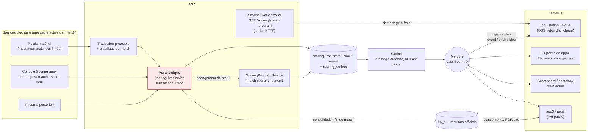
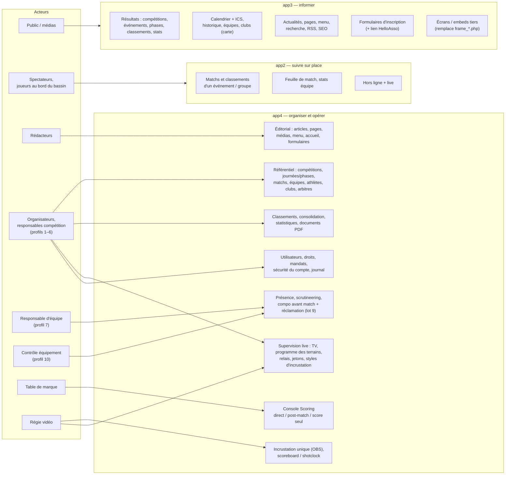
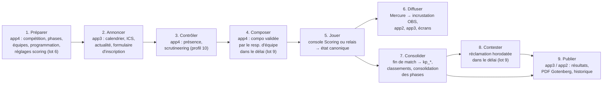

# Architecture cible de KPI — vue d'ensemble des chantiers

> **Statut : vision de synthèse (2026-11-06, état des chantiers mis à jour le 2026-11-14).** Ce document ne décide rien de nouveau : il
> **assemble** sur une seule page la cible des chantiers en cours, telle que la décrivent leurs
> documents de référence. En cas de divergence, **c'est le document du chantier qui fait foi** :
>
> | Chantier | Document de référence |
> |---|---|
> | Site public (app3, CMS, formulaires) | [PUBLIC_SITE_REDESIGN_STRATEGY.md](PUBLIC_SITE_REDESIGN_STRATEGY.md) |
> | Scoring live, console, incrustations | [LIVE_MATCH_SCORING_REFACTORING_PROPOSALS.md](LIVE_MATCH_SCORING_REFACTORING_PROPOSALS.md), [PAGE_SCORING.md](../../specs/PAGE_SCORING.md), [PAGE_INCRUSTATION.md](../../specs/PAGE_INCRUSTATION.md) |
> | PDF | [PDF_GOTENBERG.md](../../specs/PDF_GOTENBERG.md) |
> | Authentification | [AUTH_HARDENING.md](AUTH_HARDENING.md) |
> | app2 sans authentification | [PAGE_SCRUTINEERING.md](../../specs/PAGE_SCRUTINEERING.md) |
> | Médias | [MEDIA_STORAGE.md](../infrastructure/MEDIA_STORAGE.md) |
> | Serveur api2 | [FRANKENPHP_MIGRATION_ANALYSIS.md](../reference/FRANKENPHP_MIGRATION_ANALYSIS.md) |
>
> **Horizon représenté : la fin des chantiers** — `www` basculé sur app3, WordPress et `kp*.php`
> retirés, FeuilleMarque V2/V3 et les ~20 incrustations PHP supprimées (lot 8 du scoring), WSM
> remplacé par le relais matériel (lot 5). Le legacy est montré **en grisé, pointillé** : c'est le
> périmètre du ménage.
>
> Quand la cible est atteinte, ce document part dans `reference/` et décrit l'existant.

---

## 1. Principes structurants

1. **Une seule API : api2** (Symfony 7.4 LTS + API Platform 4.3, FrankenPHP en mode worker). Les
   fronts ne parlent qu'à elle. Le legacy PHP ne reçoit plus de nouvelle fonctionnalité.
2. **Trois fronts Nuxt 4, trois usages** — on ne les fusionne pas :
   - **app3** — site public SSR, indexé (`www`) : tout l'historique, l'éditorial ;
   - **app2** — PWA publique hors ligne de bord de bassin (`app.`), entrée par QR code ;
   - **app4** — administration et opérations (`/admin2`), y compris la **console Scoring** et la
     **page d'incrustation unique**.
3. **Un socle partagé `kpi-layer`** (charte FFCK, `useApi2`, composants en lecture seule), adopté par
   app3 puis par app2 et app4 (phase 6 du site public).
4. **L'état du match vit en base** (`scoring_live_*`), écrit par **une seule porte**
   (`ScoringLiveService`) ; il est **diffusé par Mercure** via une outbox transactionnelle.
   **`kp_*` reste la vérité des résultats** (consolidation en fin de match).
5. **Une page d'incrustation, des paramètres** (événement, terrain, blocs, style) au lieu de ~20 pages.
6. **PDF rendus par api2 + Gotenberg** à partir de gabarits Twig, avec contrôle d'accès.
7. **Authentification centralisée dans api2** : JWT en cookie `HttpOnly` + refresh, Google OAuth,
   TOTP pour les profils ≤ 3 ; **jetons d'affichage** (incrustations) et **jetons machine** (relais).
8. **Médias hors Git**, montés aux chemins historiques, sauvegardés par restic.

---

## 2. Schéma d'architecture cible

```mermaid
flowchart TB
    %% ---------- Acteurs / clients ----------
    subgraph CLIENTS["Utilisateurs et clients"]
        direction LR
        PUB["🌍 Public<br/>(navigateur, moteurs)"]
        SPEC["📱 Bord de bassin<br/>(QR code)"]
        ADM["🧑‍💼 Organisation<br/>profils 1–9, rédacteurs,<br/>contrôle équipement (10)"]
        TDM["⏱️ Table de marque"]
        OBS["🎥 Régie vidéo<br/>(OBS) / écrans"]
        HW["📟 Panneau propriétaire<br/>+ passerelle STOMP (LAN)"]
    end

    RELAY["Relais matériel<br/>(même code : serveur KPI<br/>ou boîtier local)"]
    HW -->|WS STOMP| RELAY

    TRAEFIK{{"Traefik — TLS + routage"}}
    PUB --> TRAEFIK
    SPEC --> TRAEFIK
    ADM --> TRAEFIK
    TDM --> TRAEFIK
    OBS --> TRAEFIK
    RELAY -->|"POST /api2/scoring/ingest<br/>(jeton machine)"| TRAEFIK

    %% ---------- Fronts ----------
    subgraph FRONTS["Fronts Nuxt 4 (socle commun kpi-layer)"]
        direction LR
        APP3["<b>app3</b> — site public<br/>Node SSR · www.*<br/>résultats, calendrier/ICS, historique,<br/>clubs, recherche, actualités, pages,<br/>formulaires, /embed"]
        APP2["<b>app2</b> — PWA publique<br/>Nginx statique · app.*<br/>suivi d'un événement,<br/>hors ligne, sans auth"]
        APP4["<b>app4</b> — admin + opérations<br/>Nginx statique · /admin2 (PWA)<br/>gestion sportive, éditorial,<br/>console Scoring, incrustation,<br/>supervision TV / relais"]
    end
    LAYER[["kpi-layer<br/>charte FFCK · useApi2 ·<br/>composants lecture seule"]]
    LAYER -.-> APP3
    LAYER -.-> APP2
    LAYER -.-> APP4

    TRAEFIK -->|"/* (défaut)"| APP3
    TRAEFIK -->|app.*| APP2
    TRAEFIK -->|/admin2/*| APP4
    TRAEFIK -->|"/api2/* (strip prefix)"| API2

    %% ---------- Back ----------
    subgraph API2["<b>api2</b> — FrankenPHP worker · Symfony 7.4 LTS · API Platform 4.3"]
        direction TB
        SEC["Security<br/>JWT cookie + refresh · OAuth Google ·<br/>TOTP ≤ 3 · jetons d'affichage · jetons machine"]
        PUBAPI["Lecture publique<br/>PublicResults · PublicSite ·<br/>Public Cms / Forms"]
        ADMAPI["Admin / Staff<br/>compétitions, matchs, équipes, présence,<br/>scrutineering, classements, CMS…"]
        SCORING["Scoring<br/>ScoringLiveService (porte unique) ·<br/>traduction STOMP · ScoringProgram ·<br/>ScoringLive (lecture)"]
        PDF["Pdf<br/>providers + Twig →<br/>GotenbergClient"]
        HUB(("Hub Mercure<br/>embarqué (SSE)"))
    end
    APP3 -->|"GET interne (SSR)"| PUBAPI
    APP2 --> PUBAPI
    APP4 --> ADMAPI
    APP4 --> SCORING
    APP4 --> PDF
    APP3 -->|liens /pdf| PDF
    HUB -->|"SSE topics<br/>/scoring/event/{e}/pitch/{p}/…"| APP4
    HUB -.->|"SSE live (cible)"| APP3
    HUB -.->|"SSE live (cible)"| APP2

    WORKER["Worker api2 (CLI)<br/>drainage outbox → Mercure ·<br/>programme des terrains"]
    GOT["Gotenberg<br/>Chromium, sans réseau"]
    PDF -->|HTTP interne| GOT
    WORKER -->|publie| HUB

    %% ---------- Données ----------
    subgraph DATA["Données"]
        direction LR
        DB[("MariaDB 11.5<br/>kp_* (résultats, référentiel) ·<br/>scoring_live_* + scoring_outbox ·<br/>CMS, formulaires, journal")]
        MEDIA[("Médias hors Git<br/>HOST_MEDIA_PATH<br/>+ sauvegarde restic")]
    end
    API2 --> DB
    WORKER --> DB
    API2 --> MEDIA

    %% ---------- Externes ----------
    subgraph EXT["Services externes"]
        direction LR
        GOOG["Google OAuth"]
        HELLO["HelloAsso<br/>(paiements)"]
        MATO["Matomo"]
        PCE["Import PCE FFCK<br/>(cron app:import-pce)"]
    end
    SEC --- GOOG
    APP3 -.-> HELLO
    APP3 -.-> MATO
    APP2 -.-> MATO
    APP4 -.-> MATO
    PCE --> DB

    %% ---------- Legacy en cours de retrait ----------
    subgraph LEGACY["Legacy — à retirer (grisé)"]
        direction LR
        APACHE["Apache + mod_php<br/>kp*.php, frame_*.php,<br/>admin/ (FeuilleMarque V2/V3),<br/>Pdf*.php (mPDF), sources/api"]
        WP["WordPress + dbwp"]
        LIVEPHP["~20 incrustations<br/>live/*.php + app_live"]
        CACHE["Cache JSON<br/>event_worker / create_cache_match"]
        WSM["app_wsm (onglet Chrome)<br/>+ /api/wsm/*"]
        BROKER["Broker WebSocket<br/>personnel"]
    end
    TRAEFIK -.->|"liste explicite de préfixes,<br/>jusqu'au décommissionnement"| APACHE

    classDef legacy fill:#eeeeee,stroke:#9e9e9e,stroke-dasharray:5 4,color:#8a8a8a;
    classDef front fill:#e3f2fb,stroke:#357b9c,color:#1e1e1c;
    classDef back fill:#fbe9e9,stroke:#882831,color:#1e1e1c;
    classDef data fill:#f4f4f4,stroke:#1e1e1c,color:#1e1e1c;
    class APACHE,WP,LIVEPHP,CACHE,WSM,BROKER legacy;
    class APP2,APP3,APP4,LAYER front;
    class SEC,PUBAPI,ADMAPI,SCORING,PDF,HUB,WORKER,GOT back;
    class DB,MEDIA data;
    style LEGACY fill:#fafafa,stroke:#bdbdbd,stroke-dasharray:5 4,color:#8a8a8a
```

### 2.1 Routage cible (Traefik)

| Hôte / préfixe | Destination | Remarque |
|---|---|---|
| `www.*` `/*` (défaut) | **app3** (Node SSR) | devient le routeur par défaut à la bascule (phase 5) ; `beta.*` d'ici là |
| `www.*` `/api2/*` | **api2** (FrankenPHP) | priorité haute, `stripprefix` → `DEFAULT_URI` inclut `/api2` |
| `www.*` `/admin2/*` | **app4** (Nginx statique) | console Scoring et incrustation incluses |
| `app.*` | **app2** (Nginx statique) | URL imprimée sur les QR codes : inchangée |
| liste explicite (`/admin/*`, `/Pdf*.php`, `/frame_*.php`, `/live/*`, `/api/*`…) | Apache legacy | **se vide** au fil du décommissionnement ; c'est la checklist du ménage |

### 2.2 Conteneurs cibles

| Conteneur | Rôle cible | Évolution |
|---|---|---|
| `${APPLICATION_NAME}_api2` | API unique + hub Mercure | inchangé ; en production (FrankenPHP + hub) ; reste à éprouver le hub avec le scoring (lot 0, action 0.3) |
| `${APPLICATION_NAME}_app3` | SSR du site public | passe de `beta.*` à `www` |
| `${APPLICATION_NAME}_nginx_static` | app2 et app4 statiques | inchangé |
| `${APPLICATION_NAME}_gotenberg` | rendu PDF | inchangé |
| `event-cache-worker` | **drainage outbox + programme des terrains** | perd la génération du cache JSON (lot 8) |
| `db` | MariaDB principale | + tables `scoring_live_*`, `scoring_outbox`, CMS, formulaires |
| `dbwp` | ~~WordPress~~ | **retiré** après archive (phase 6 du site public) |
| `${APPLICATION_NAME}_php` (Apache) | ~~legacy~~ | **résiduel puis retiré** ; voir §5, point ouvert n° 1 |
| relais matériel | client STOMP → api2 | **nouveau** (lot 5) ; côté serveur ou en boîtier, selon le site |

---

## 3. Le flux live cible (écriture → diffusion)

Règles qui rendent ce flux sûr (détail dans le plan scoring §3–§4) :

- **Les horloges ne voyagent pas** : on stocke 4 valeurs (durée, écoulé, dernier départ, en marche)
  et chaque écran interpole localement ; le réseau ne transporte que play/pause.
- **Une seule source écrit à la fois** ; la promotion de source se fait depuis la supervision app4.
- **Horodatage client** et identifiants uniques → rejeu idempotent (relais, offline lot 7).
- **Topics hiérarchiques** `/scoring/event/{e}/pitch/{p}/{score|clock|shotclock|penalty|fact|program}` :
  isolation des événements simultanés, abonnement au strict nécessaire.

---

## 4. Schéma fonctionnel cible

### 4.1 Qui fait quoi, avec quelle application

### 4.2 La vie d'une compétition, de bout en bout

**Objectif transverse : zéro papier** — présence, compo, feuille de marque, réclamation et PDF
officiels sont tous numériques et journalisés (`kp_journal`).

---

## 5. Ce qui disparaît, et quand

| Legacy | Remplacé par | Condition de retrait |
|---|---|---|
| WordPress + `dbwp`, `kp*.php`, `json-*.php`, Smarty « material » | app3 + CMS api2 | bascule `www` (phase 5) puis décommissionnement (phase 6) |
| `frame_*.php` (écrans, iframes tiers) | app3 `/embed/…` + thèmes | phase 7 du site public |
| `Pdf*.php`, `Feuille*.php` (mPDF) | api2 `/pdf/*`, `/admin/pdf/*` + Gotenberg | catalogue cible en production (phases 0–5) ; retrait = phase 6 de [PDF_GOTENBERG.md](../../specs/PDF_GOTENBERG.md) § 12 |
| FeuilleMarque V2 / V3, `live/v2/*.php` | console Scoring app4 | lot 3 validé en réel + garde-fou chiffré (action 0.6) |
| ~20 incrustations `live/*.php`, `app_live` | page d'incrustation unique | lot 4 validé, bascule terrain par terrain |
| Cache JSON (`event_worker.php`, `create_cache_match.php`) | `GET /state` + Mercure | après les incrustations legacy |
| `app_wsm` + `/api/wsm/*`, broker WebSocket | relais matériel + Mercure | lot 5 |
| Authentification et scrutineering d'app2 | app4 (profil 10) | ✅ fait |
| `admin/` legacy, `Login.php`, `sources/api/` | app4 + api2 | au fil des migrations de pages ; pas de rétrofit sécurité |

> **Garde-fou** : le ménage (lot 8) n'a lieu qu'avec un **critère chiffré et daté** (ex. « 3
> événements réels complets sans un écart avec la fiche de référence »), sinon le double chemin
> devient permanent.

### Points ouverts que la cible ne tranche pas encore

1. **Qui sert `/img/*` et les médias quand Apache disparaît ?** `nginx_static` (montage du
   `HOST_MEDIA_PATH`) est le candidat naturel ; à décider avant l'arrêt d'Apache.
2. **Convergence app2 ↔ app3** : réévaluée après la bascule (décision du site public §2.3). La cible
   ci-dessus garde deux applications.
3. **Live public dans app3/app2** : polling d'abord, abonnement aux topics Mercure publics ensuite
   (flèches en pointillé) — dépend du lot 2 validé en production.
4. **TV Control Panel** ([PAGE_TV_CONTROL_PANEL.md](../../specs/PAGE_TV_CONTROL_PANEL.md)) :
   les voies/scénarios `kp_tv` restent tant que les écrans legacy existent ; à terme, le
   programme des terrains et les réglages d'enchaînement de l'incrustation (§7 de sa spec)
   en couvrent l'essentiel.

---

## 6. État des chantiers au 2026-11-14

| Chantier | État | Prochaine étape |
|---|---|---|
| api2 sur FrankenPHP + hub Mercure | 🟢 en production (préprod et prod) | éprouver le hub avec le scoring live (lot 0, action 0.3) |
| app3 (site public) phases 1–4 | 🟢 en production sur `beta.*`, mesure d'audience Matomo sans cookie en service | phase 5 : bascule de `www` ([checklist](PUBLIC_SITE_ROLLOUT_CHECKLIST.md)) |
| app2 sans authentification | 🟢 livré | adoption de `kpi-layer` (phase 6) |
| PDF Gotenberg | 🟢 phases 0–5 en production | validations écrites des commissions (PDF-DOC-03), puis phase 6 : retrait de `Feuille*.php` / `Pdf*.php` / mPDF |
| Auth hardening | 🟡 phases 1a, 1b, 2 livrées ; 1b-bis (appareils) et 1b-ter (continuité de session, lot A) en cours | TOTP ciblé (phase 3) — [AUTH_HARDENING.md](AUTH_HARDENING.md) |
| Scoring lots 1–4 (état canonique, Mercure, console, incrustation) | 🟡 essayés en dev (juillet–octobre), **jamais validés de bout en bout** ; lot 4 jamais passé dans OBS | porte de validation de [SCORING_ROLLOUT_CHECKLIST.md](SCORING_ROLLOUT_CHECKLIST.md) (R0 → R5) |
| Scoring lots 5–9 (relais, paramétrage, offline, ménage, zéro papier) | 🔴 non commencés | après la porte de validation |
| Médias hors Git | ✅ fait (dev, preprod, prod) | — |
| Médailles de match, catégorie d'âge dérivée, réalignement des structures FFCK | ✅ en production (novembre 2026) | — |
